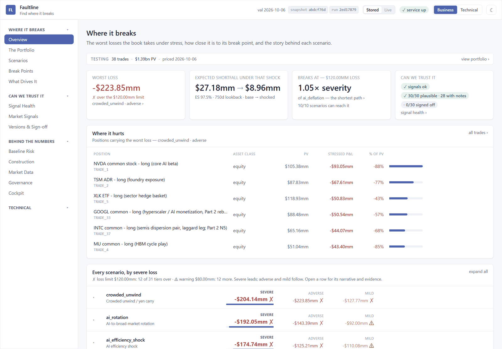
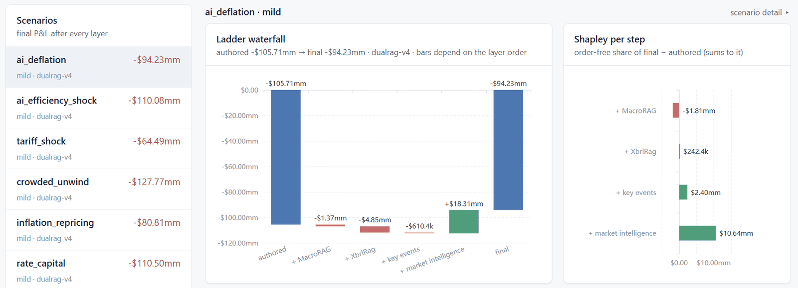
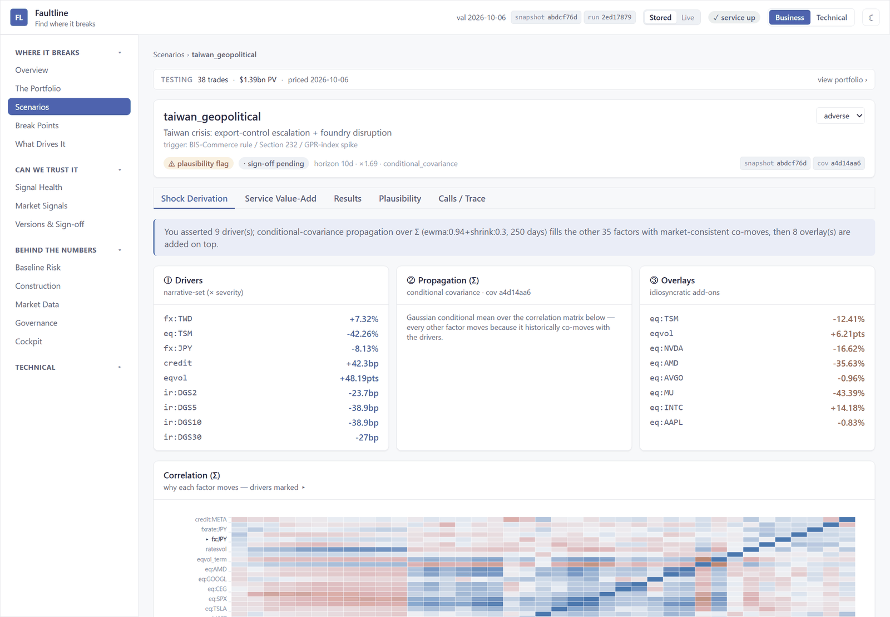
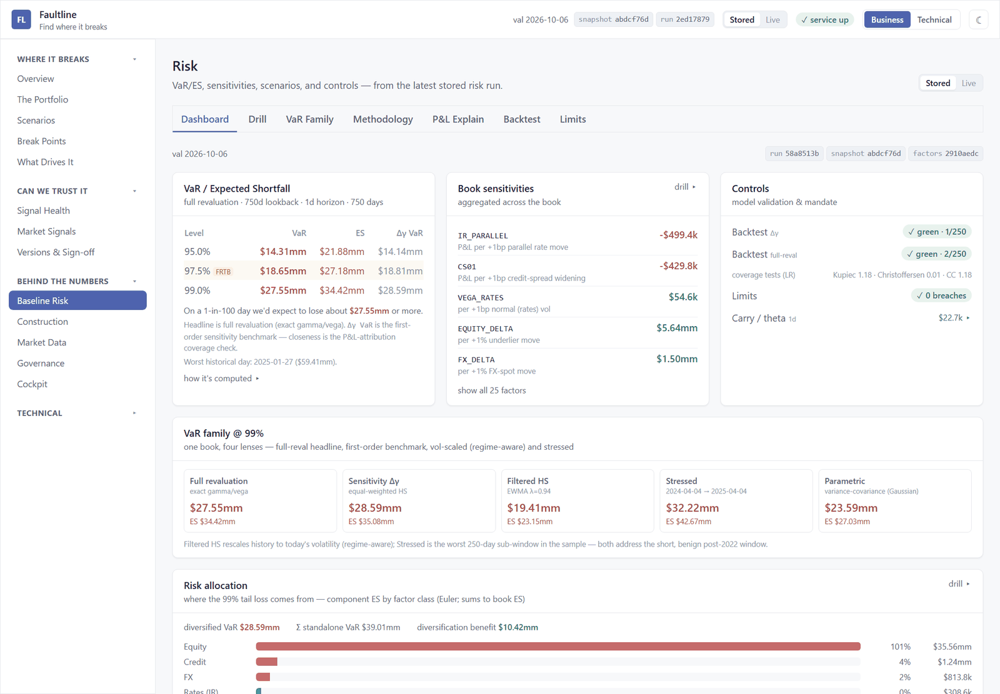
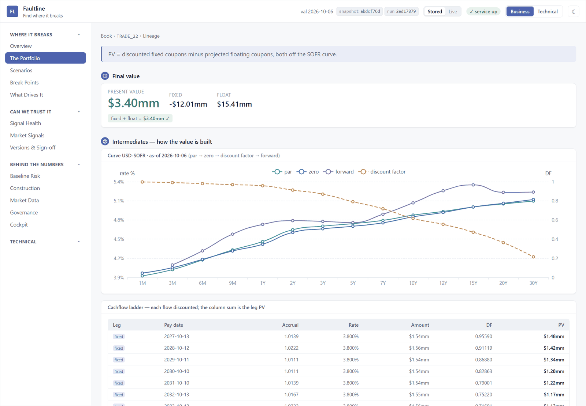

<h1 align="center">Faultline</h1>

<p align="center">
  <b>Find where your portfolio breaks.</b><br>
  An open, reproducible risk desk for an <b>AI-themed, multi-asset portfolio</b>: QuantLib pricing,
  VaR/ES, correlated stress scenarios grounded in market history and research, and rebalancing, with
  every number traceable to the data and code that produced it.
</p>

<p align="center">
  
  
  
  
  
  <a href="LICENSE"></a>
</p>

> **The 38-trade book is an illustrative design, not a real portfolio. Nothing here is investment
> advice.**

---

## Why Faultline

Most stress tests are a spreadsheet of hand-picked shocks applied to a few positions. Faultline treats
the question *"what happens to this book if…?"* the way a desk would:

- **Built around the AI trade.** The book concentrates the AI theme — chip makers, hyperscalers,
  AI-capex credit, power — and the scenario library asks what happens when that theme cracks.
- **Every trade is priced, not approximated.** QuantLib engines revalue all 38 trades — equities,
  American options, SOFR swaps, Bermudan swaptions, caps, bonds, CDS and FX — on a bootstrapped SOFR
  multi-curve.
- **Scenarios are anchored to what markets have actually done.** Each named shock is calibrated to a
  real episode, propagated to every other risk factor through the factor covariance, and sized into
  mild / adverse / severe tiers from history.
- **AI proposes, evidence decides.** Scenario drivers can come from macro research and SEC filings
  (with citations), or from an LLM agent working through tools, and both paths fail loudly when the
  evidence isn't there.
- **Every number can be reproduced.** Results carry the git SHA, config hash, QuantLib version and a
  content-addressed fingerprint of the exact market data used. Same inputs, same number.

<p align="center">
  <a href="docs/images/screens/overview.png">
    
  </a>
  <br>
  <sub>The stress-first overview: the worst scenario loss against the limit, expected shortfall under
  that shock, how far the book is from its break point, and the positions driving the loss.
  Valued 2026-10-06.</sub>
</p>

## Questions it answers

| You want to know… | Faultline gives you… |
|---|---|
| What does a Taiwan foundry disruption do to this book, and which trades drive the loss? | Correlated scenario P&L per trade, by severity tier, with factor attribution |
| How bad is a bad day? | Historical, filtered-HS and stressed VaR / ES, full revaluation and delta-gamma, component ES by trade |
| Is the VaR model any good? | Backtests (Kupiec, Christoffersen), P&L explain, a parametric cross-check, limits |
| How large a move would it take to lose $X? | Reverse stress testing |
| How should the book be sized to a risk budget? | Risk-appetite sizing to a VaR budget, with a rebalance blotter |
| Can we prove last quarter's number? | Run provenance + market-data snapshot ids on every result, golden-PV regression, IPV |

## The scenario library

Ten named scenarios, each tied to a market episode and sized from history:

| Scenario | Anchored to |
|---|---|
| AI efficiency shock | The DeepSeek cheaper-model shock, 27 Jan 2025 |
| Tariff / trade-war shock | "Liberation Day", 2–8 Apr 2025 |
| Crowded unwind / yen carry | 10 Jul – 5 Aug 2024 (USD/JPY −12%, VIX 13 → 39) |
| AI → broad-market rotation | 10–24 Jul 2024 (SMH −14%, QQQ −8%) |
| Inflation and real-rate repricing | 16 Aug – 14 Oct 2022 (2Y +123bp, 10Y +118bp) |
| AI deflation, multi-month | The 2022 peak-to-trough (NVDA −66%, SMH −44%) |
| AI-capex credit repricing | Oct 2025 – Jan 2026 (Oracle 5Y CDS ~54bp → ~157bp) |
| Fiscal / term-premium bear steepener | 2023-Q3 analog (10Y +100bp, 30Y +150bp) |
| Taiwan crisis | Export-control escalation and foundry disruption, scaled by geopolitical-risk indices |
| Largest-name event | An earnings miss or key-person event at the largest long, sized from its option-implied distribution |

On the research-grounded path, each scenario is enriched with news, crowding, options and
SEC-filing signals; every scenario passes a plausibility gate and is versioned with a sign-off record. You can also generate new scenarios with an
LLM agent (OpenAI, Anthropic or DeepSeek) that works through tools, with every call's cost tracked.

Layer ablation shows what each research layer actually changes. Each scenario is re-run with the
layers added one at a time, and an order-free Shapley share credits each layer with its part of the
move:

<p align="center">
  <a href="docs/images/screens/ablation.png">
    
  </a>
  <br>
  <sub>AI deflation, mild tier: authored −$105.7mm → final −$94.2mm, layer by layer. Valued 2026-10-06.</sub>
</p>

## See it in action

<table>
  <tr>
    <td width="33%" valign="top">
      <a href="docs/images/screens/scenario.png"></a>
      <br><sub><b>Scenario detail.</b> Taiwan crisis, adverse tier: 9 asserted drivers, propagated to
      the other 35 factors through the covariance, plus single-name overlays.</sub>
    </td>
    <td width="33%" valign="top">
      <a href="docs/images/screens/risk.png"></a>
      <br><sub><b>Risk.</b> VaR / ES at 95, 97.5 and 99%, book sensitivities, backtests and limits,
      and five VaR methods side by side.</sub>
    </td>
    <td width="33%" valign="top">
      <a href="docs/images/screens/lineage.png"></a>
      <br><sub><b>Calculation lineage.</b> A SOFR payer swap's PV built from its two legs, the curve,
      and every discounted cash flow.</sub>
    </td>
  </tr>
</table>

<sub>Screenshots of the local UI, valued 2026-10-06 on market-data snapshot <code>abdcf76d</code>.</sub>

---

## Architecture at a glance

Market data, pricing, risk and scenario generation are chained through an immutable,
content-addressed market-data **snapshot**, so every downstream number is reproducible:

<p align="center">
  <a href="docs/images/architecture.svg">
    
  </a>
</p>

- **No database server.** Everything runs from source over CSV and Parquet, queried in-process with
  DuckDB. The same code and container images run on a laptop or against S3 (`PRICER_DEPLOY_MODE`).
- **Free public data only.** US Treasury, NY Fed, FRED, Pensford, DTCC swap-data repositories, FINRA,
  SEC EDGAR, CBOE, ECB and more — nothing vendor-licensed is committed.
- **A UI for two audiences.** A business lens (exposures, scenario losses, capital) and a technical
  lens (calculation lineage, run traces, provenance) over the same results.

## The book

An AI-themed, multi-asset book of **38 trades across 6 asset classes and 11 instrument types**:
cash equities and ETFs, American equity options, SOFR swaps, European and Bermudan swaptions, caps,
corporate and Treasury bonds, single-name and index CDS, and FX forwards. The USD curve is built from
the Pensford SOFR forward curve; the default valuation date is **2026-10-06**.

Every instrument type has a [methodology write-up](docs/pricing/README.md) (Black-Scholes-Merton
and finite differences, Bachelier, Hull-White trees, the ISDA CDS model, covered interest parity),
and every trade has a short write-up of its economics, inputs and live valuation.

---

## Quick start

Full setup, the `.env` table and the end-to-end run order are in the
[operator handbook](docs/guides/README.md#one-time-setup). The essentials:

```powershell
# QuantLib is the PyPI wheel, installed into a Python 3.12 env (here: conda env py312).
conda activate py312
pip install -r requirements.txt -r requirements-service.txt -r requirements-dev.txt
$env:PYTHONPATH = $PWD.Path   # the repo root

# A minimal end-to-end cycle (each step reads the previous step's output from data/):
python -m src.marketdata.rates.runner   # (+ equity / fx / bonds / credit / options / stress)
python -m scripts.marketdata.dq_gate    # data-quality gate: PASS or FAIL
python -m src.pricer.runner             # prices the book; writes the snapshot everything pins to
python -m src.pricer.risk_runner        # risk pack
python -m src.scenariogen.runner        # correlated stress scenarios

# Then the UI: the BFF on :8088 and the React app on :5173.
uvicorn ui.bff.app.main:app --port 8088 --reload
npm run dev   # in ui/app, Node v24.14.0
```

### Getting the data

No market data ships with this repo: `data/` is gitignored and the feeds belong to their publishers.
The ingest runners above download free public data to your machine. The
[market data guide](docs/guides/marketdata_guide.md) covers every runner, source and setting.

Set these in `.env` first (template: [.env.example](.env.example)):

- `FAULTLINE_CONTACT_EMAIL`: your contact, which SEC EDGAR and other sources require in the User-Agent.
- `PENSFORD_SUPABASE_ANON_KEY`: the public key the Pensford forward-curve page sends, needed to pull the
  current SOFR curve. The guide shows where to find it.

**Tests.** `pytest` works on a fresh clone: about 870 tests run with no data, and about 160 that read
market data skip with a pointer to the guide. They stay skipped until the core feeds are in (forward
curve, equity prices, Treasury yields, option chains), and a full ingest is what gets them all passing.

## Explore further

| If you want to… | Start here |
|---|---|
| Run each subsystem (flags, outputs, troubleshooting) | [Operator handbook](docs/guides/README.md) · [market data](docs/guides/marketdata_guide.md) · [pricer](docs/guides/pricer_guide.md) · [risk](docs/guides/risk_guide.md) · [scenarios](docs/guides/scenariogen_guide.md) · [LLM flow](docs/guides/scenariogen_llm_flow.md) · [UI](docs/guides/ui_guide.md) |
| See how each trade is priced | [docs/pricing/](docs/pricing/README.md) |
| Understand the design decisions | [docs/design/](docs/guides/README.md#design-documents-deep-background) |
| Deploy with Docker, Kubernetes or AWS | [Deployment guide](docs/guides/deployment_guide.md) · [AWS design](docs/design/AITrade_aws_deployment_design.md) |
| Work in the code with Claude Code | [CLAUDE.md](CLAUDE.md) and the per-module `CLAUDE.md` files |

<details>
<summary><b>Repository layout</b></summary>

```
src/marketdata/     11 asset-class download pipelines + shared common/ (http, store, config, dq)
src/pricer/         QuantLib pricer (input → loader → ql) + risk/ sizing/ governance/ output/ obs/
src/scenariogen/    correlated stress + dual-RAG (arag/ macro/) + agentic LLM (llm/) paths
src/common/         shared observability, config, provenance, quality gate, snapshot,
                    storage/ (local-FS | S3 façade), jobs/ (deploy-mode job runner)
ui/app/             Vite + React + TypeScript frontend      ui/bff/  FastAPI backend-for-frontend
configs/            per-module JSON config, validated with pydantic
scripts/            operational scripts (dq_gate, verify_*, Pensford rebuild, image build/push, …)
tests/              pytest suites (pricer, marketdata, scenariogen, bff) + locked spec tests
docs/               guides/ (how to run) · design/ (why) · pricing/ (per instrument and per trade)
infra/              Dockerfiles, Kubernetes batch jobs; docker-compose.yml / .aws.yml at the root
data/               all outputs (gitignored): CSV feeds, Parquet stores, JSON reports
```

</details>

<details>
<summary><b>Engineering and quality gate</b></summary>

- **Gate:** `ruff check .` → `mypy` (strict over `src/common`, `src/pricer`, `src/scenariogen`,
  `src/marketdata`) → `pytest`. Config in [pyproject.toml](pyproject.toml); CI in
  [.github/workflows/pricer-ci.yml](.github/workflows/pricer-ci.yml). `pytest` works on a fresh clone:
  tests that read market data skip until the core feeds are in `data/marketdata/`.
- **Test-first changes:** each change starts from a written spec and locked spec tests
  ([.claude/tdd/](.claude/tdd/oracles.md)), so behaviour is pinned before the code is written.
- **Fail loud by design:** ingest floors, the data-quality gate and the scenario grounding gate raise
  rather than silently substitute.
- **Requirements:** [requirements.txt](requirements.txt) (core) ·
  [requirements-service.txt](requirements-service.txt) (FastAPI / BFF) ·
  [requirements-dev.txt](requirements-dev.txt) (ruff / mypy / pytest).

</details>

---

## License and support

MIT — see [`LICENSE`](LICENSE). [QuantLib](https://www.quantlib.org/license.shtml) is installed from
PyPI and carries its own BSD-style license.

**Market data.** Nothing vendor-licensed is committed: the ingest runners download free public data
into the gitignored `data/` tree on your machine. You are responsible for following each source's
terms of use. Some sources (Yahoo Finance, the Federal Reserve H.10 and Taiwan CBC FX pages) only
answer requests that look like a browser, so their configs send a browser User-Agent. The SEC, GPR
and EPU sources identify you instead: set `FAULTLINE_CONTACT_EMAIL` in `.env` (see
[`.env.example`](.env.example)) or they fail.

This is a personal project, shared as-is: no support, no stability guarantees, and no promise to
review issues or pull requests. Not investment advice (see the note at the top).
